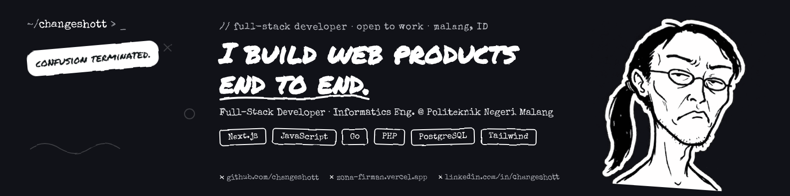

<code>Full-Stack Developer · Next.js · Go · PHP · PostgreSQL · Open to internships &amp; collabs</code>

  
  

---

### 👋 Hey, I'm **changeshott** — a.k.a. Zona Firman Maulana

A full-stack developer from Malang, Indonesia, who builds web products **from the database to the last pixel — and actually ships them.**

- 🎓 Informatics Engineering student @ Politeknik Negeri Malang
- 🏫 Almost 2 years as a Software Developer at SMK Islam Batu, building systems the school uses every day
- 🔨 Starting fresh on a new set of projects — stay tuned
- 🌱 Currently leveling up in Next.js, Go and clean database design
- 💬 Ask me about **web development, backend and clean code**

> *"Confusion Terminated."* — turning confusing problems into clear solutions.

---

### 🧰 Tech Stack

**Languages**

  
  
  
  
  

**Frontend**

  
  
  

**Backend, Data & Tools**

  
  
  
  

---

### 🌟 Featured Projects

> 🚧 **Work in progress.** New projects will show up here soon — follow me or ⭐ my repos for updates.

<!-- When your first project is ready, replace the block above with a card like this:
#### 🔹 [Project Name](repo-link)
One sentence: what problem it solves and for whom.
`Next.js` `PostgreSQL` `Tailwind`
[🌐 Live](demo-link) · [📦 Repo](repo-link)
-->

---

<!-- GitHub Stats are hidden until there are public repos with code (the cards render empty otherwise). Uncomment when ready.
### 📊 GitHub Stats

  
  
   
  

-->

---

**Open to:** internships · freelance web projects · open-source collaboration

📫 The fastest way to reach me: [LinkedIn](https://www.linkedin.com/in/zona-firman-maulana-3366253a0) or [email](mailto:changeshott@gmail.com)

